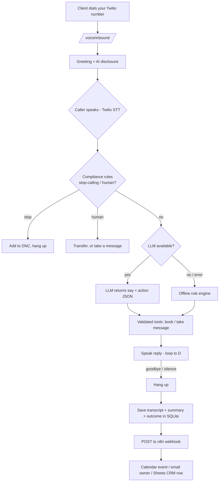
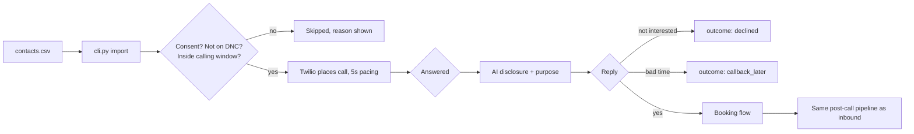

# Call workflow

## Inbound (client calls you)

## Outbound (you call clients)

## Outcomes
`appointment_booked`, `message_taken`, `transferred`, `answered_questions`, `declined`, `callback_later`, `do_not_call`, `no_response`.

## n8n setup (free, self-hosted)
1. `docker compose up n8n` and open http://localhost:5678.
2. Import `workflows/n8n_post_call.json`; connect Google Calendar / Sheets / SMTP credentials; set your Sheet ID.
3. Activate it and set `N8N_WEBHOOK_URL=http://n8n:5678/webhook/voice-agent-call` in `.env`.

Payload sent by the agent: `{event, call{id,call_sid,direction,phone,started,ended,transcript,summary,outcome}, appointments[], messages[]}`.
